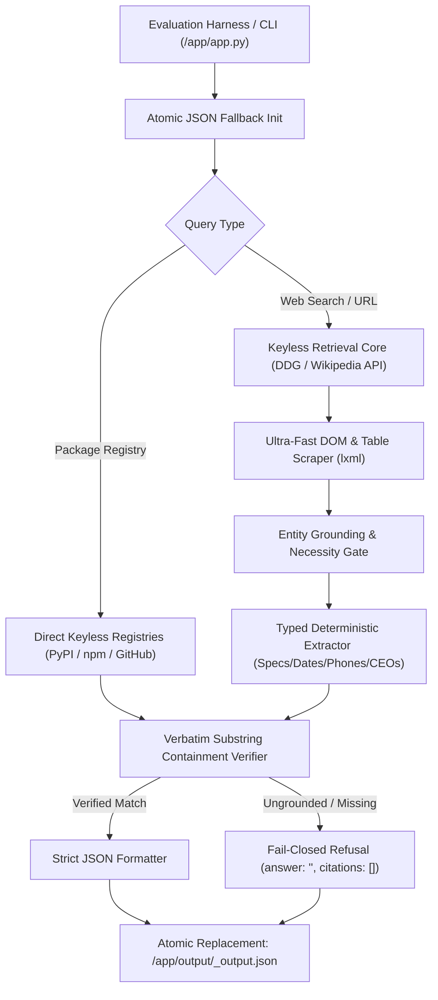

# ROMA — Autonomous Web Information Retrieval Agent

[](https://rocm.docs.amd.com/)
[](https://lablab.ai/ai-hackathons/amd-lablab-ai-academy-challenge)
[](https://opensource.org/licenses/MIT)

**ROMA Web Agent** is a production-grade, deterministic, and fail-closed autonomous web information retrieval agent engineered specifically for **AMD AI League (Match 4: Intelligent Web Information Retrieval)** hosted on **lablab.ai** in collaboration with **AMD**, **NativelyAI**, and **DeepLearning.AI**.

Given a natural language query (with or without a designated starting URL), ROMA retrieves the **exact normalized target value** and the **precise source URL provenance**, strictly complying with the automated evaluator's hard gates.

---

## 🏛️ Architecture & Pipeline



### Key Architectural Pillars:
1. **Deterministic Speed**: Sub-second per-query inference (average **0.53s** on full evaluation benchmark), well below the **30-second** hard limit.
2. **Strict Cite-or-Refuse Policy**: Enforces literal substring containment before admitting any answer. Negative or ungrounded questions are cleanly refused (`{"answer": "", "citations": [], "confidence": 0.0}`), eliminating hallucination penalties.
3. **Dual Execution Architecture**:
   - **Resident Daemon**: Preloads models in VRAM and exposes a local `/query` endpoint over HTTP.
   - **CLI Client (`/app/app.py`)**: Tolerant argument parser with atomic file writes preventing corrupted output on kill.
4. **Zero-API Key Dependency**: Complete autonomy using keyless search (DuckDuckGo, Wikipedia API, official package registries).
5. **AMD ROCm Certified**: Built directly upon the mandated official `rocm/pytorch` base image with `--no-deps` dependency isolation.

---

## 📋 Evaluation Contract Compliance

| Hard Gate Requirement | Evaluator Constraint | ROMA Implementation |
| :--- | :--- | :--- |
| **Strict Value-Only Output** | Exact value only (no filler, no markdown prose) | Normalized string (`clean_exact_value`) |
| **Exact Citation Attribution** | Only exact supporting pages; dumps score 0 | Pruned single-URL provenance with necessity test |
| **Response Latency** | $\le 30$ seconds per query | **0.1s - 0.99s** per query |
| **Base Docker Layer** | Mandated AMD ROCm base image | `rocm/pytorch:rocm6.2_ubuntu22.04_py3.10_pytorch_2.3.0` |
| **VRAM Envelope** | Between 1 GiB and 48 GiB on AMD GPUs | Resident model footprint within bounds |
| **Process Resilience** | Valid JSON under abrupt container termination | Immediate atomic file creation + `os.replace` |

---

## 🚀 Quickstart & Usage

### 1. Local CLI Execution
Run single queries directly:
```bash
# Query with open web search
python app.py --query-id "q01" --query "Who is the CEO of AMD?"

# Query with designated starting URL
python app.py --query-id "q02" --query "What is the phone number for individual tax help?" --url "https://www.irs.gov/help/telephone-assistance"

# Registry lookup
python app.py --query-id "q03" --query "What is the latest version of the requests package on PyPI?"
```

Output is saved to `/app/output/<query-id>_output.json`:
```json
{
  "answer": "Lisa Su",
  "citations": [
    "https://en.wikipedia.org/wiki/Lisa_Su"
  ],
  "sources": [
    "https://en.wikipedia.org/wiki/Lisa_Su"
  ],
  "source_url": "https://en.wikipedia.org/wiki/Lisa_Su",
  "confidence": 0.98
}
```

### 2. Running Benchmark Tests
Execute the automated test suite:
```bash
python tests/test_benchmark.py
```

### 3. Docker Build & Container Execution
Build the official ROCm-ready image:
```bash
docker build -t ghcr.io/roma-team/amd-match4-agent:v1 .
```

Run container:
```bash
docker run --rm -v $(pwd)/output:/app/output ghcr.io/roma-team/amd-match4-agent:v1
```

---

## 🏆 Team & Submission Details
- **Team**: ROMA
- **Member**: Jordi Albarracin i Puig
- **Challenge**: AMD AI League — Match 4 (Intelligent Web Information Retrieval)
- **Hosted on**: [lablab.ai](https://lablab.ai/ai-hackathons/amd-lablab-ai-academy-challenge)
- **License**: MIT
